# Session Workbench tutorial

From download to your first claude session, step by step.
The README is the reference for every detail;
  this tutorial takes you through the app in the order you will meet it.

**Contents**

1. [What the app is for](#1-what-the-app-is-for)
2. [Download and install](#2-download-and-install)
3. [Prepare the agent host](#3-prepare-the-agent-host)
4. [Share your files with the agent host](#4-share-your-files-with-the-agent-host)
5. [The first start](#5-the-first-start)
6. [Settings](#6-settings)
7. [Hosts](#7-hosts)
8. [Your first session and your first claude](#8-your-first-session-and-your-first-claude)
9. [GitHub: what the agent host can and cannot do](#9-github-what-the-agent-host-can-and-cannot-do)
10. [The session tabs](#10-the-session-tabs)
11. [Commands and prompts for every session](#11-commands-and-prompts-for-every-session)
12. [Review before you commit](#12-review-before-you-commit)
13. [Keeping an eye on many sessions](#13-keeping-an-eye-on-many-sessions)
14. [Organising the session list](#14-organising-the-session-list)
15. [Cost and subscription usage](#15-cost-and-subscription-usage)
16. [Backups, recordings and moving a project](#16-backups-recordings-and-moving-a-project)
17. [More: keys, contrast, profiles, files](#17-more-keys-contrast-profiles-files)
18. [Troubleshooting](#18-troubleshooting)

The screenshots show a made-up setup:
  an agent host `agent-vm` and four sessions.
They are taken by `scripts/tutorial-shots.sh`, so they stay current with the app.

## 1. What the app is for

Session Workbench runs many Claude Code sessions side by side,
  each bound to one project directory.
claude runs on a separate machine, the **agent host**:
  a virtual machine, a second computer, or a container on your own computer.
Your own computer, the **host**, keeps your git credentials, ssh keys and tokens.

The split is the point of the app.
claude can read and change the code on the agent host,
  but it cannot push to GitHub, because the credentials never reach that machine.
You review what claude did and push it yourself, from your own computer.

```
 your computer ("host")                            agent host (VM, machine or container)
 ┌─────────────────────────────┐                   ┌──────────────────────────────┐
 │ Session Workbench           │   ssh (terminal)  │ tmux session cw-<id>         │
 │   Remote tab ───────────────┼──────────────────►│   └─ claude                  │
 │   Local tab: your shell     │                   │                              │
 │   Files tab: your files     │                   │ the project, shared or       │
 │ git + push credentials      │   file access ◄──►│ copied (see section 4)       │
 └─────────────────────────────┘                   └──────────────────────────────┘
```

The app currently supports **Claude Code** only as the agent.
A session's start command can run anything,
  but the app's extras (idle stop, cost, usage, backups) are made for claude.

## 2. Download and install

Every tagged version is on the GitHub **Releases** page:
  <https://github.com/maarten-boot/session-workbench/releases>.

| File | For | Install |
|---|---|---|
| `session-workbench_…_amd64.deb` | Ubuntu 24.04+, Debian 13+ | `sudo apt install ./session-workbench_…_amd64.deb` |
| `session-workbench-…x86_64.rpm` | Fedora 40+ | `sudo dnf install ./session-workbench-…x86_64.rpm` |
| `…-linux-amd64.tar.gz` | other Linux | unpack; needs WebKitGTK 4.1 and GTK 3 |
| `…-windows-amd64.zip` | Windows 10/11 | unpack; SmartScreen asks once: *More info → Run anyway* |
| `…-macos-universal.zip` | macOS 12+ | unpack; the first time right-click the app → *Open* |

The Windows and macOS builds are not code-signed, hence the one-time question.
The deb and rpm packages add a menu entry and install what the app needs.

On your computer the app uses `ssh`, and optionally:
- `git`, for the Files tab's git status and for working copies;
- `rsync`, for faster backups and working copies (without it the app copies files itself);
- `gh`, the GitHub CLI, for the build runs in the Web tab.

`session-workbench -version` prints the version; Settings shows it too.

## 3. Prepare the agent host

Any Linux machine you can reach with ssh will do.
macOS works too.
It needs:

- **ssh login with a key**, without a password prompt.
  Try `ssh me@agent-vm true`: it must return without asking anything.
  If it asks for a password:
  ```sh
  ssh-keygen -t ed25519            # once, if you have no key yet
  ssh-copy-id me@agent-vm
  ```
- **tmux**, so claude keeps running when the connection drops or the app closes.
- **claude**, Claude Code itself, installed for the user you log in as:
  ```sh
  curl -fsSL https://claude.ai/install.sh | bash     # installs into ~/.local/bin
  ```
  `~/.local/bin` must be on the PATH of a login shell (`~/.profile` or `~/.bashrc`).
- **rsync** for the Claude backups, and **git** if you use working copies (section 4).

Check it the way the app will see it:

```sh
ssh me@agent-vm 'exec "$SHELL" -lc "command -v tmux"'
ssh me@agent-vm 'exec "$SHELL" -lic "command -v claude"'
ssh me@agent-vm 'command -v rsync git'
```

Each line must print a path.
The app installs nothing on the agent host.
It only keeps each session's shell history there, in `~/.local/state/session-workbench/history/`.

The app connects with your own `ssh`, so `~/.ssh/config`, host aliases and ProxyJump all work.
It always switches off agent forwarding, X11 and port forwarding,
  so the agent host cannot use your keys.

## 4. Share your files with the agent host

claude on the agent host has to see the project.
There are four ways;
  pick one per host when you add it (section 7).

| Your situation | Use |
|---|---|
| The agent host is a VM on your computer (KVM/libvirt) | A shared file system: a **virtiofs** share |
| The agent host is on your LAN and NFS is possible | A shared file system: **NFS** |
| A Windows computer, or a Samba server | A shared file system: **SMB/CIFS** |
| No shared file system, the agent host is reachable by ssh | **Live share over ssh** |
| The agent host is less trusted, or you work with rsync today | **Working copy** |
| No second machine; a separate environment per project | **A container on this computer** |

With a shared file system the same files appear on both machines,
  usually under different paths.
You tell the app how the paths map with a **local prefix** and a **remote prefix**,
  for example `/home/me/share` here and `/mnt/share` on the agent host.
Share a work area, not your whole home directory,
  and keep secrets outside it: the agent host can read everything in the share.

### NFS

On your computer, export the work area to the agent host only.
In `/etc/exports`:

```
/home/me/share  192.168.122.0/24(rw,sync,no_subtree_check,root_squash)
```

Then `sudo exportfs -ra`.
On the agent host:

```sh
sudo mkdir -p /mnt/share
sudo mount -t nfs 192.168.122.1:/home/me/share /mnt/share
```

Or add it to `/etc/fstab`,
  or use autofs with the `-hosts` map,
  which mounts it on demand under `/net/192.168.122.1/home/me/share`.
Your user id must be the same on both machines (`id -u`), otherwise files belong to someone else.

### KVM: a virtiofs share

For a VM on your own computer no network file system is needed:
  libvirt shares a folder straight into the VM.
In virt-manager:
- *Memory*: tick *Enable shared memory*;
- *Add Hardware → Filesystem*: driver *virtiofs*,
  source path `/home/me/share`, target path `share`.

Or in the VM's XML (`virsh edit agent-vm`):

```xml
<memoryBacking>
  <source type='memfd'/>
  <access mode='shared'/>
</memoryBacking>
...
<devices>
  <filesystem type='mount' accessmode='passthrough'>
    <driver type='virtiofs'/>
    <source dir='/home/me/share'/>
    <target dir='share'/>
  </filesystem>
</devices>
```

Restart the VM, then inside it:

```sh
sudo mkdir -p /mnt/share
sudo mount -t virtiofs share /mnt/share
echo 'share /mnt/share virtiofs defaults 0 0' | sudo tee -a /etc/fstab   # at every boot
```

virtio-9p works too (`<driver type='path'/>` and `mount -t 9p -o trans=virtio`),
  but virtiofs is faster.
As with NFS, use the same user id inside the VM as on your computer.

### SMB/CIFS

A share from Windows or a Samba server, mounted on the agent host:

```sh
sudo mount -t cifs //mypc/share /mnt/share \
    -o credentials=/root/.smb-share,uid=$(id -u),gid=$(id -g)
```

`/root/.smb-share` holds `username=` and `password=` lines (`chmod 600`).
Watch file permissions and symlinks; they behave less like a Linux file system.

### Live share over ssh

No set-up beyond `sshfs` on the agent host (`sudo apt install sshfs`):
  the app serves the session directory itself, over the ssh connection it opened,
  and the agent host mounts it under `~/sw/`.
The agent host never logs in to your computer and sees nothing outside the session directory.
The share only lives while the app runs:
  close the app or let the laptop sleep, and claude loses its files until the app reconnects.
The bar above the tabs shows *● shared* while it works.

### Working copy

Each session gets a copy on the agent host.
**⇡ Send** copies your directory there;
  **⇣ Get** fetches the commits claude made, as branches `agent-<id>/<branch>`,
  and lets you take them over.
Nothing the agent host does reaches your computer until you Get it,
  and then only commits.
Create the session for the repository's top folder, so `.git` goes along.
*Full ▾* next to the tabs has full transfers:
  save the whole agent copy, take all files, send everything, or restore a saved copy.

### A container on this computer (Docker or Podman)

A host of the kind *containers on this computer* runs each session in its own container,
  on Linux or macOS, with Podman or Docker.
Nothing needs sharing:
  the session directory is mounted into the container **at the same path**,
  and you are the same user there, so files claude makes belong to you.
The container sees that directory and nothing else of yours.

The image comes from the session's Dockerfile
  (session menu → *Dockerfile…*: the project's `.session-workbench/Dockerfile`,
  or one in the app's data folder).
The template is Ubuntu with sshd, tmux, git, build tools and Claude Code;
  buttons add Go, Node.js, Python, Rust or Java.
Session menu → *Services (compose)…* adds a database or web server next to it.
The first connect builds the image, which takes a few minutes.
Claude Code's login lives in a volume (`sw-claude`), shared by all container sessions.

## 5. The first start

Start Session Workbench from the menu, or `session-workbench` in a terminal.
The first time there are no hosts yet:

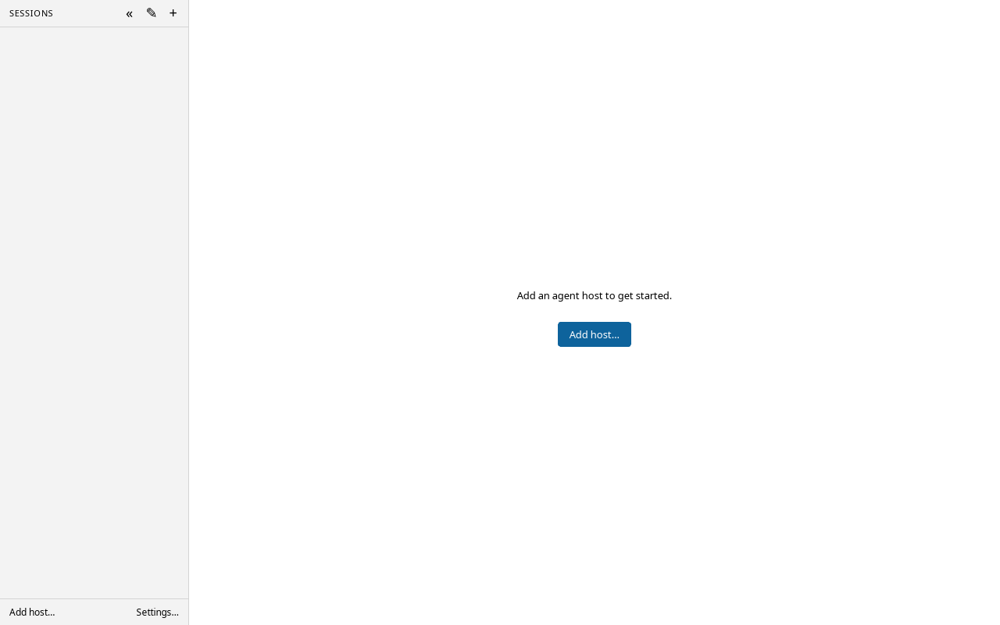

**Add host…** opens the host dialog, described in section 7.
After that, **New session…** takes its place.
**Settings…** at the bottom left is always there.

## 6. Settings

Open Settings with **Settings…** at the bottom of the session list,
  or Ctrl+Shift+, (comma).
Have a look before your first session; everything has a sensible default.

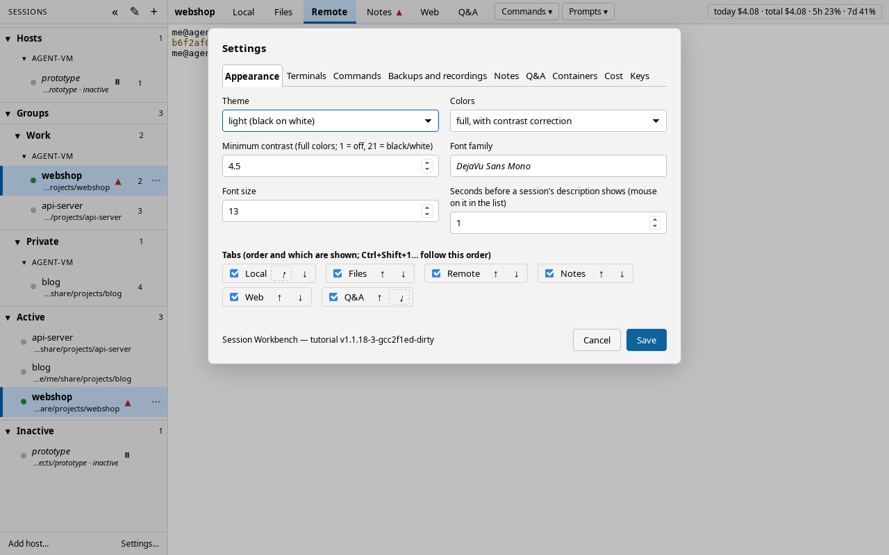

| Page | What you set there |
|---|---|
| Appearance | theme, colors and minimum contrast, font and size, which tabs show and in which order |
| Terminals | copy and paste keys, desktop notifications, reconnecting, stopping an idle claude |
| Commands | the command menu (section 11) and the start commands of new sessions |
| Backups and recordings | Claude backups of each agent host, Remote tab recordings, saved working copies |
| Notes | spelling: on or off, the language, your own words |
| Q&A | who answers in the Q&A tab and with which model |
| Containers | Podman or Docker, for container hosts |
| Cost | the cost figure, warnings and each session's cost (section 15) |
| Keys | keyboard shortcuts |

All of it is stored in `config.toml` (section 17), which you can also edit by hand.

## 7. Hosts

**Add host…** asks for:

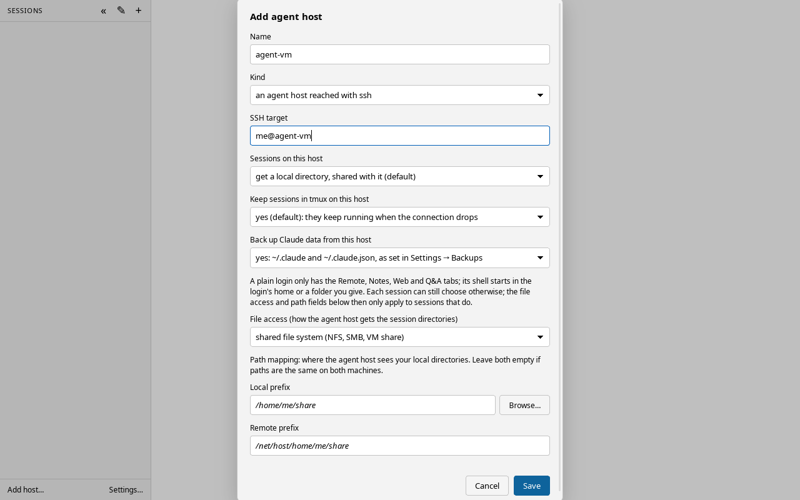

- **Name**: what the app calls it, e.g. `agent-vm`.
- **Kind**: an agent host reached with ssh, or containers on this computer.
- **SSH target**: anything `ssh` accepts, `me@agent-vm` or an alias from `~/.ssh/config`.
- **Sessions on this host**: normally they get a local directory, shared with the host.
  The other choice makes them plain ssh logins, without files: handy for a quick login.
- **Keep sessions in tmux**: yes, unless the host has no tmux.
- **Back up Claude data**: yes for hosts where claude runs (section 16).
- **File access**: shared file system, live share over ssh, or working copy (section 4).
- **Local prefix / remote prefix**: for a shared file system,
  where the same directory is on each side.
  Leave both empty if the paths are identical.

Right-click a host in the list (or its ⋯) for its menu:

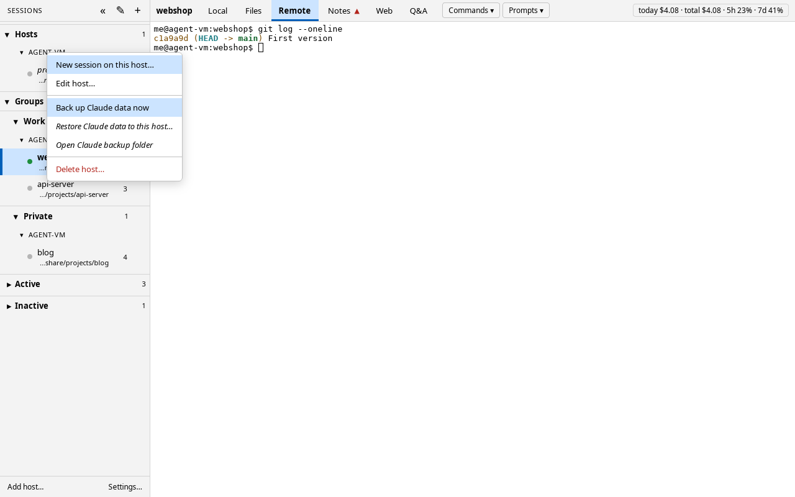

*New session on this host…*, *Edit host…*, the Claude backup actions, and *Delete host…*.
You can add as many hosts as you like;
  each session belongs to one of them.

## 8. Your first session and your first claude

**New session** (the **+** at the top of the list, or Ctrl+Shift+N):

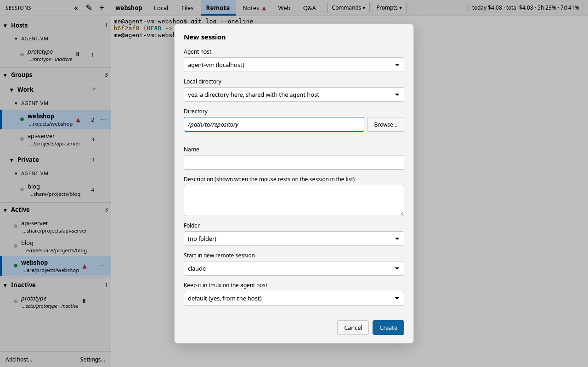

- **Agent host**: where claude will run.
- **Directory**: the project, on your computer, under the host's local prefix.
  The dialog shows where it appears on the agent host, or why it can't be used.
- **Name** (defaults to the directory's name) and a **description**,
  shown when the mouse rests on the session in the list.
- **Folder**: put it in a group such as *Work* (section 14).
- **Start in new remote session**: what the Remote tab starts, see below.

**Create**, and the session opens.
Go to its **Remote** tab (Ctrl+Shift+3):
  the app logs in to the agent host,
  starts tmux in the project directory and runs the start command.

The start commands, set in Settings → Commands:
- `claude`: a new conversation;
- `claude-continue`: continues the directory's last conversation (`claude --continue || claude`);
- `shell`: just a shell.

Add your own, such as `claude --model opus`.

### The first claude on a new agent host

claude on a fresh agent host does not know you yet.
The first time it asks you to **log in**:
- choose your account type (a Claude subscription, or an API key);
- claude shows a link: open it in the browser on your own computer,
  log in, and copy the code it gives you;
- paste the code into the Remote tab.

claude keeps the login on the agent host (in `~/.claude/`),
  so this is once per agent host, not once per session.
You log in again after the agent host was reinstalled,
  or when claude asks for it after a long time.
The app's Claude backups leave the login out on purpose, so a restored host asks once too.
Container sessions share one login, kept in the `sw-claude` volume.

Then trust the folder when claude asks, and give it its first task.
claude keeps running in tmux on the agent host:
  close the app, come back tomorrow, and the Remote tab picks up where it was.

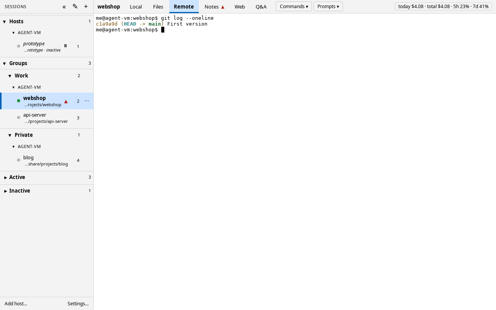

*In the screenshot the Remote tab shows a shell; normally claude runs there.*

## 9. GitHub: what the agent host can and cannot do

Normally the agent host has **no write access to GitHub**.
That is the purpose of the app:
  claude writes code, you decide what leaves your computer.
claude can still commit on the agent host (a shared folder means a shared `.git`),
  but pushing, merging and tagging happen from your Local tab, with your credentials.

Read access is often useful, though:
  claude can look at an issue, a pull request or a failing build run
  when it has `gh`, the GitHub CLI.
Give it a **fine-grained token that can only read, for only the repositories it works on**.
Never use `gh auth login`'s browser flow on the agent host:
  that gives a token with full access to all your repositories.

### A read-only token for the agent host

1. On github.com: your picture → **Settings → Developer settings**
   → **Personal access tokens → Fine-grained tokens → Generate new token**.
2. **Token name**: e.g. `agent-vm read-only`.
   **Expiration**: short, e.g. 30 or 90 days.
3. **Repository access**: *Only select repositories*, and pick the projects claude works on.
4. **Permissions → Repository permissions**, each *Read-only*:
   - *Contents* (code, branches, releases),
   - *Issues*,
   - *Pull requests*,
   - *Actions* (build runs and their logs),
   - *Metadata* (always on).

   Leave every other permission at *No access*.
5. **Generate token** and copy it.

On the agent host, install `gh`
  (`sudo apt install gh`, or see <https://cli.github.com>),
  then hand it the token without leaving it in your shell history:

```sh
read -rs GH_RO && printf '%s' "$GH_RO" | gh auth login --with-token && unset GH_RO
gh auth status          # shows the account; the token's permissions are the ones you picked
gh issue list -R me/webshop
```

Paste the token at the silent `read` prompt and press Enter.
Do **not** run `gh auth setup-git`:
  git on the agent host has no reason to use the token.
Even if it did, a read-only token cannot push.

Keep in mind that claude can read the token;
  that is why it can only read, only those repositories, and expires.
When it expires, make a new one and repeat.

## 10. The session tabs

Each session has six tabs.
Ctrl+Shift+1 … 6 selects them;
  Settings → Appearance changes their order or hides some.

### Local: your own shell

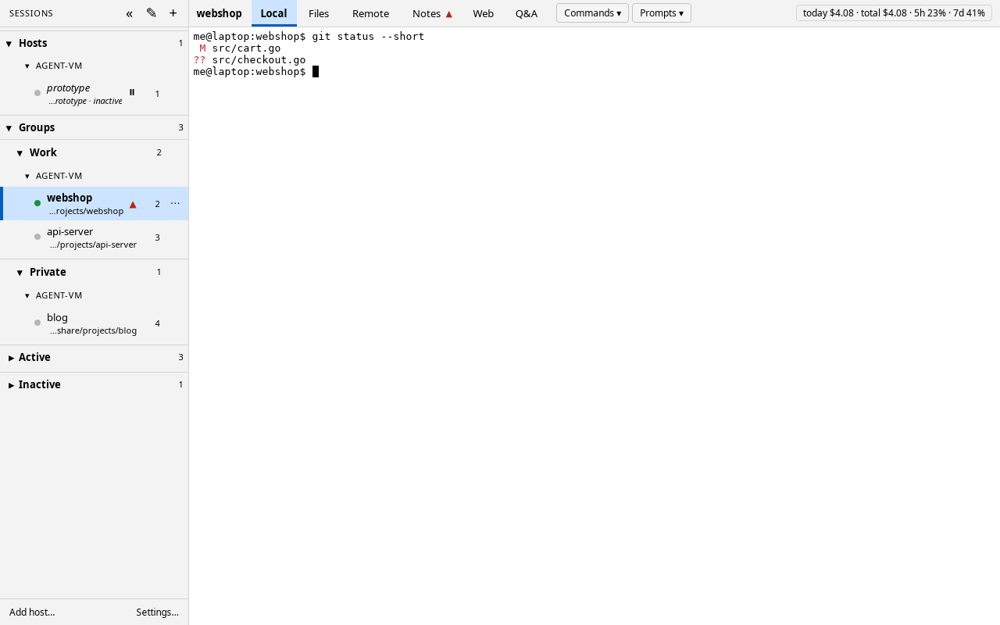

A shell on your computer, in the project directory.
This is where you review, commit and push:
  `git diff`, `git commit`, `git push`, with your own credentials.

### Files

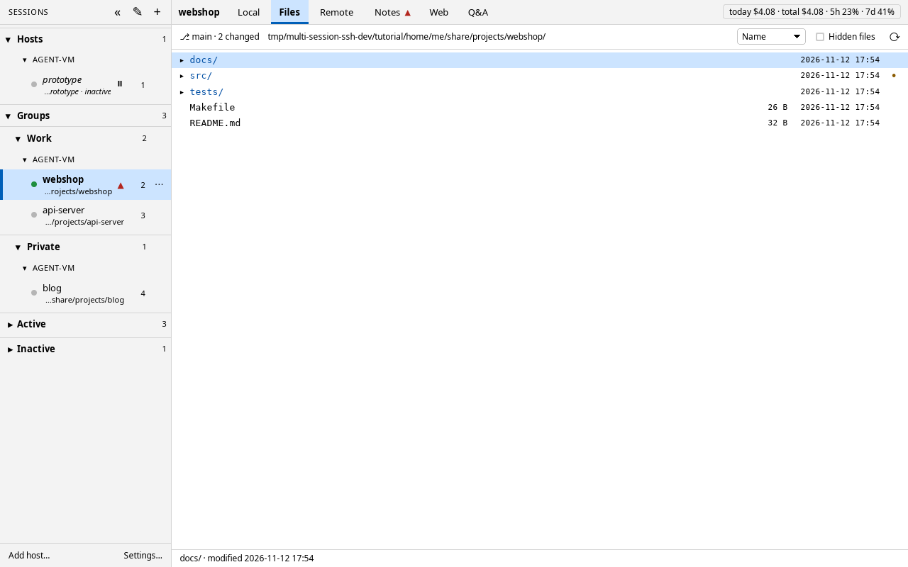

The project as a tree, with sizes, dates and git status letters
  (**M** modified, **A** added, **U** untracked…; the bar shows the branch).
Double-click opens a file with its usual application.
Programs are never run from here,
  and a symlink pointing out of the project is shown but not followed:
  the agent host could have planted it.

### Remote: claude

The terminal on the agent host, in tmux.
It survives closing the app and lost connections;
  the app reconnects by itself.
When claude exits, you get a shell there.

### Notes

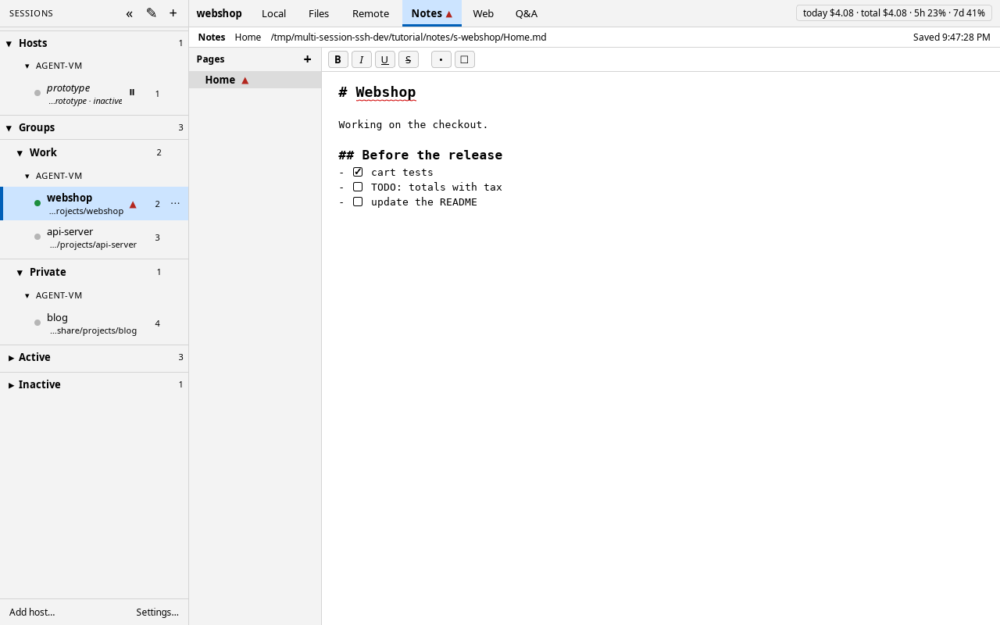

Your notes about the project, as pages in a tree:
  plans, decisions, things to check.
They are Markdown, shown with their formatting,
  with check lists, spelling, and **B I U S** buttons.
Notes are stored with the app's config, not in the project:
  they stay out of git and off the agent host.

**TODO alert**: any line with the word `TODO` in capitals puts a red **▲**
  on the session in the list, on its Notes tab and on the page.
Hover it to see how many and where.
Change the word (to `DONE`, say) or remove the line, and the ▲ goes.
Use it as a reminder that survives closing the app:
  `TODO: ask claude about the tax rounding`.

### Web

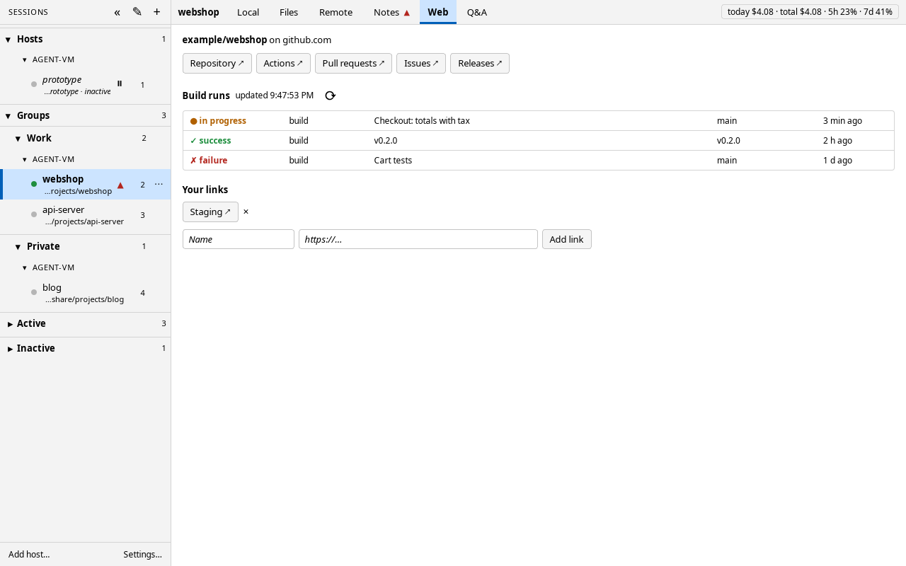

- **Buttons** for the repository's pages:
  Repository, Actions, Pull requests, Issues and Releases on GitHub (GitLab gets the same).
  They are read from the project's git remote.
- **Build runs**: the latest GitHub Actions runs, with status, branch and age,
  refreshed while you look and every 15 seconds while one is running.
  Click a run to open it in your browser.
  This uses `gh` **on your own computer**, logged in with `gh auth login`;
  the app itself stores no tokens.
- **Your links**: anything else for this project, such as a staging site or a ticket.

Pages open in your normal browser.

### Q&A

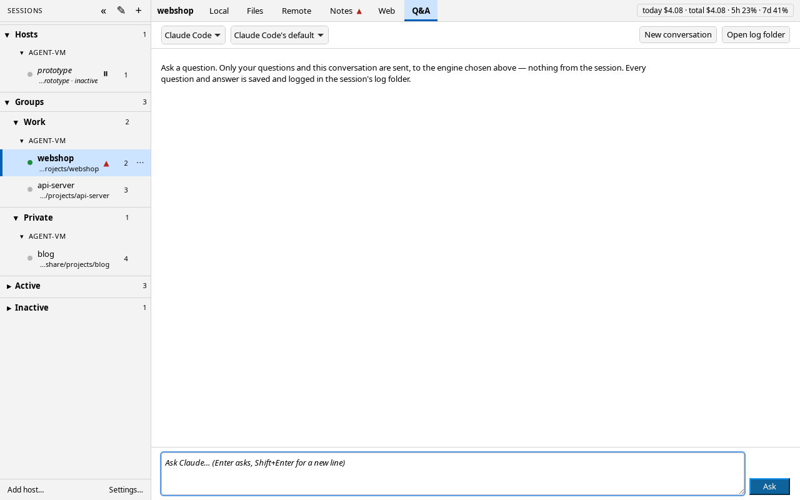

A side conversation with Claude, apart from the session's claude:
  ask how something works without disturbing the work in the Remote tab.
It sees only your questions, nothing from the session.
It answers through the Claude API (with an API key),
  through Claude Code on your computer (your subscription, no tools),
  or your own command.
Each session keeps its conversation, and every question and answer is logged.

## 11. Commands and prompts for every session

Commands and prompts you set up once are available in **every** session.
The screenshots show a real set, used daily while developing this app:
  [examples/settings.toml](tutorial/examples/settings.toml) (with the commands)
  and [examples/prompts.md](tutorial/examples/prompts.md).
Copy what you like.

### The command menu

**Commands ▾** next to the tabs, or right-click a terminal:

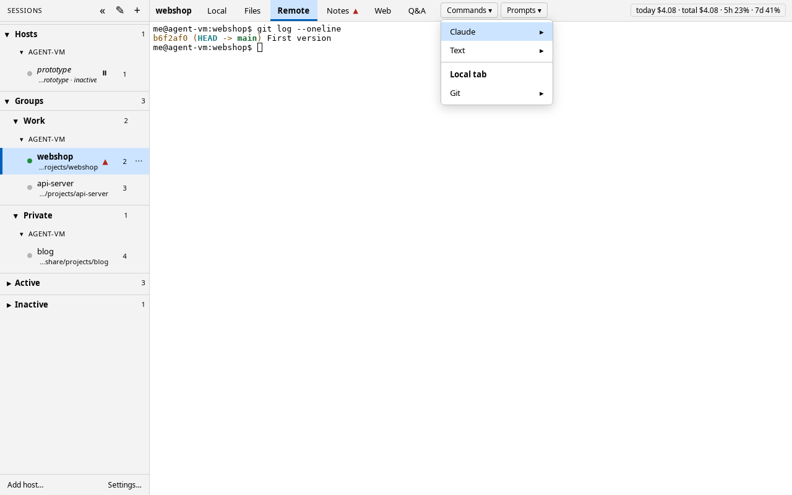

A command is typed into the terminal and, if you like, Enter pressed.
Make them in Settings → Commands; each session can add its own in *Edit…*.
- **Group** puts commands in a submenu (*Claude ▸*, *Git ▸*, *Text ▸*).
- **Where** sends a command to the Local or the Remote tab,
  whichever tab you choose it in.
  `git push` with *Where: Local* runs on your computer
  while you stay in the Remote tab watching claude.
  The menu lists the other tab's commands in a section of their own (*Local tab*).

Commands are not only for the shell.
The *Claude* group types claude's own commands (`/compact`, `/exit`) into the Remote tab;
  the *Text* group holds replies you give claude again and again:
  `you can continue`, `i pushed`, `status?`, `What is next ?`.

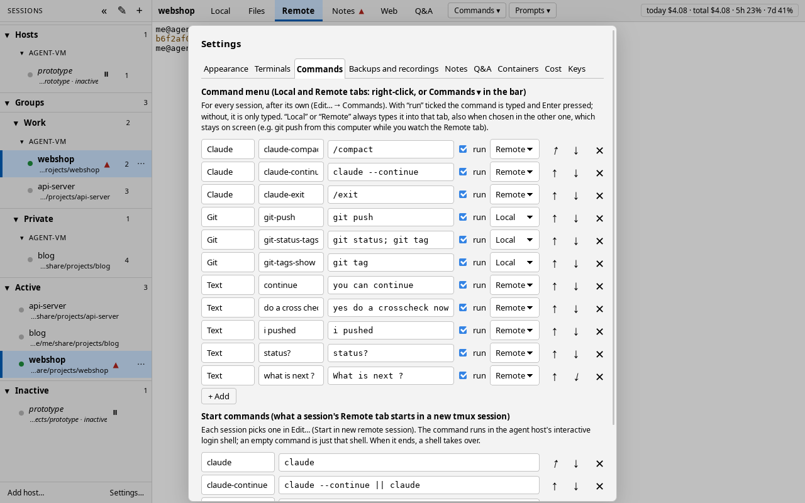

The same page holds the **start commands** of section 8.

### Prompts

Prompts you give claude often live in the **notes for all sessions**:
  ✎ at the top of the session list, or Ctrl+Shift+M.
On the page named *Prompts* (and its subpages), every `## name` heading starts a prompt:

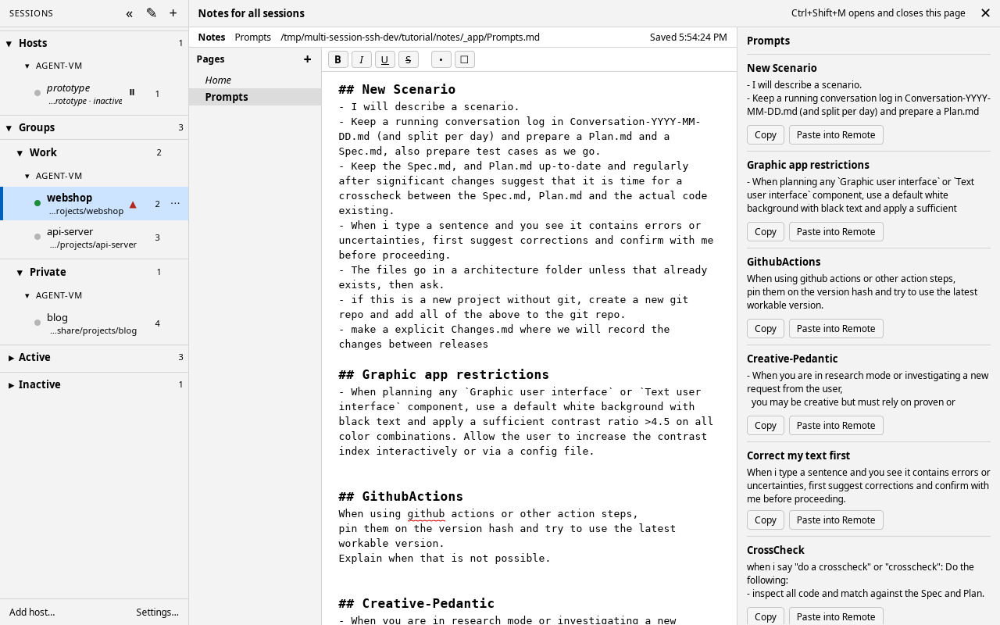

**Prompts ▾** next to the tabs pastes one into the terminal you are in:

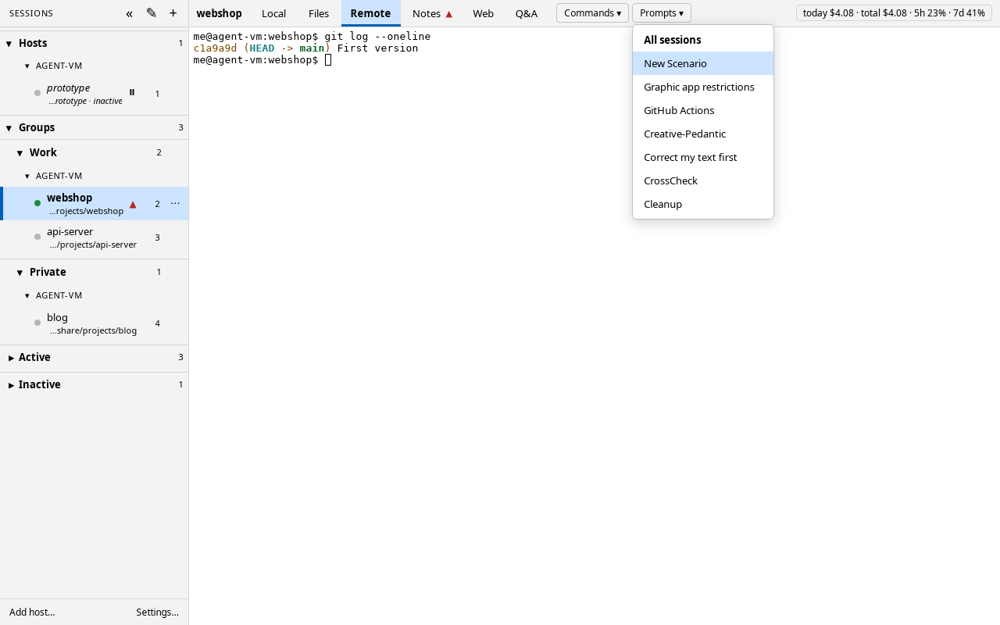

claude gets it as pasted text, and runs it when you press Enter.
A session's own *Prompts* page, in its Notes, comes first in the menu.
So:
- a page *Prompts* in the notes for all sessions: prompts for every project;
- a page *Prompts* in a session's Notes: prompts for that project only.

The example prompts set ground rules for a new project (*New Scenario*),
  ask for a cross-check of spec, plan and code (*CrossCheck*),
  or remind claude of house rules (*Graphic app restrictions*, *Cleanup*).
Paste one at the start of a conversation, or whenever claude needs reminding.

## 12. Review before you commit

With a shared folder or a live share, the agent host can write into the project's `.git` folder.
git on your computer trusts what it finds there:
  a planted hook or config setting would run on **your** computer the next time you commit or push.

The app checks every session's repository for active hooks
  and for config settings that run programs or redirect pushes.
If it finds one, the session gets a **⚠** and the Files tab a banner;
  **Details…** lists each item, why it matters, and a command to inspect or remove it.
If they are yours (pre-commit, husky, git-lfs), **Mark as reviewed**;
  the warning returns when anything changes.

So the daily loop is:
1. claude works in the Remote tab;
2. you look at the result in the Files and Local tabs (`git diff`);
3. no ⚠? Commit and push from the Local tab.

`docs/CONNECTIVITY.md` explains the risks and how to check by hand.

## 13. Keeping an eye on many sessions

The dot before each session shows its Remote connection:
  **green** connected, **orange** reconnecting or ended,
  **red** something is wrong (the reason is in the bar above the tabs), **grey** not connected yet.

A session you are not looking at gets a mark when something happens there:
- an **orange dot** when a terminal rings the bell;
- a **blue ring** when it starts printing again after a quiet spell.

The window title counts them: `(2) webshop — Session Workbench`.

**Desktop notifications**: when claude waits for you in a session you are not looking at,
  a notification says *Claude is waiting*; clicking it opens that session.
For that, claude must ring the bell when it waits:
  run `/config` in claude on the agent host and set the notification channel to *terminal bell*.

**Stopping an idle claude**: every claude takes 300–400 MB on the agent host, also while it waits.
Settings → Terminals → *Stop claude when it waited for input* (off by default)
  stops a claude that got no input for 5 minutes to 2 hours,
  and resumes the same conversation when you open the session.
The list marks a stopped session with 💤.

Rest the mouse on a session for its balloon:
  path, description, cost and TODO lines.

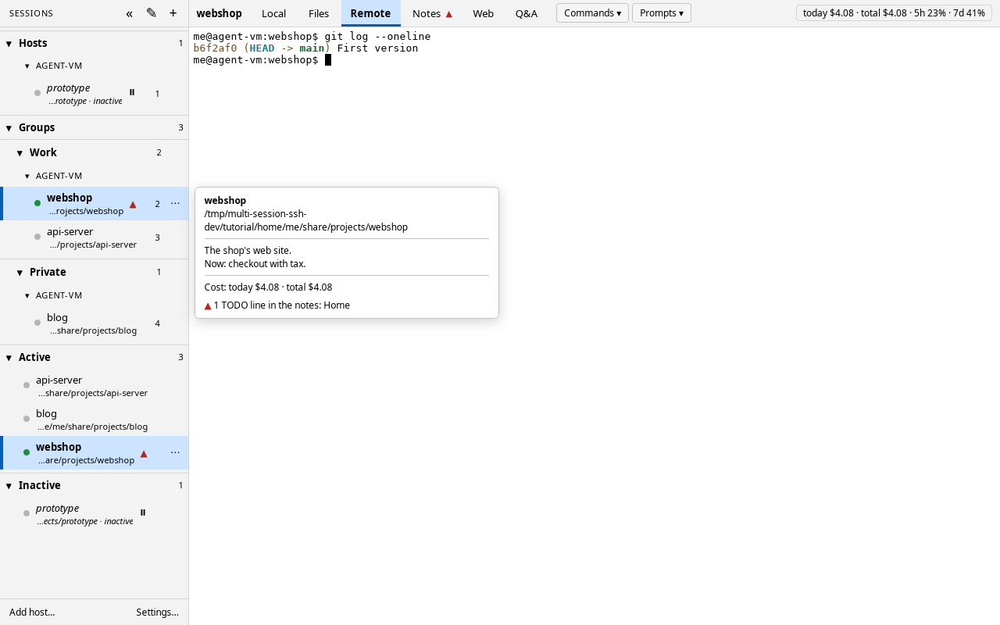

## 14. Organising the session list

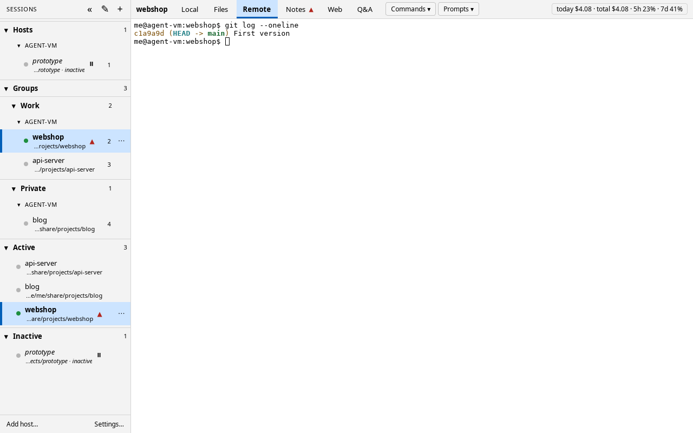

- **Hosts** lists the sessions that are in no folder, by host.
- **Groups** holds your folders, such as *Work* and *Private*:
  **+** → *New folder…*, then drag a session onto it, or *Move to folder…*.
  Folders can hold folders.
- **Active** and **Inactive** list every session again, by name,
  so you find one without knowing its folder.
  Its balloon then also says the host and folder.

Click a heading to fold it.
The **quick switcher** (Ctrl+Shift+P) finds a session:
  type a few letters of its name, folder or description.

Right-click a session (or its ⋯) for its menu:

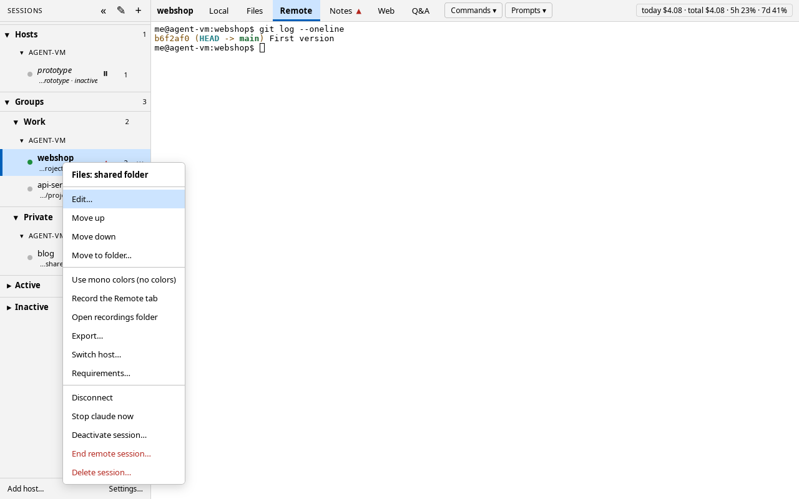

**Deactivate session…** parks a session you keep for later:
  it connects nothing, not at start and not when you open it,
  and by default ends its tmux session on the agent host, which stops claude there.
Notes, Files, Web and Q&A keep working.
**Activate session** brings it back.

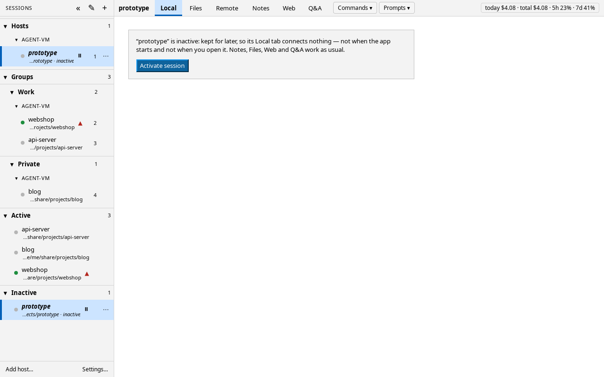

## 15. Cost and subscription usage

The top right of the window shows what claude cost:
  `today $4.08 · total $4.08 · 5h 23% · 7d 41%`.

- **The amounts** are what claude's work would cost at API prices,
  counted from claude's own transcripts on each agent host,
  also of claude runs the app did not start.
  With a subscription you don't pay these; they show what you use.
- **5h and 7d** are your subscription's 5-hour and 7-day usage (Pro, Max or Ultra),
  as claude reports them with each reply.

Click the figure for Settings → Cost:

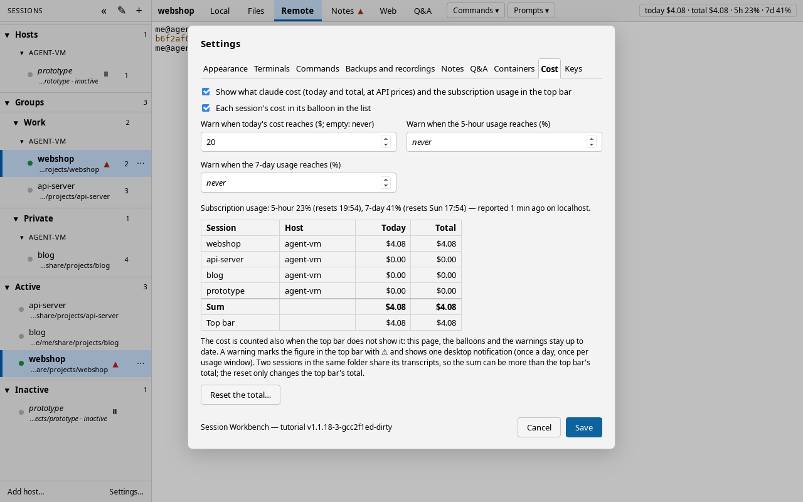

Each session's cost, a sum, a reset of the total,
  and **warnings**: when today's cost or the usage reaches a limit you set,
  that part of the figure turns red with a ⚠, and a desktop notification tells you once.

You can hide the figure (*Show what claude cost … in the top bar*, `show_cost = false`).
The cost is still counted:
  Settings → Cost, the balloons and the warnings stay up to date,
  so you can keep the top bar quiet and look only when you want to.

## 16. Backups, recordings and moving a project

**Claude backups**: the agent host is the machine most likely to be lost,
  and with it claude's conversations, memory and settings in `~/.claude`.
The app copies `~/.claude` and `~/.claude.json` of every agent host to your computer,
  every hour by default (Settings → Backups and recordings).
Backups only grow: what is deleted on the agent host stays in the backup.
A new or reinstalled agent host gets it back with host menu → *Restore Claude data to this host…*;
  restore **before** starting claude there, then log in once.

**Recordings**: Settings → Backups and recordings (or the session menu)
  records the Remote tab to a log file, for later reference.

**Switch host…** (session menu) moves a session to another agent host,
  say from the machine at work to the one at home.
claude's conversations for the project go along.
**Requirements…** keeps a list of the tools the project needs and checks them on a host.

**Export…** (session menu) puts a session in a `.zip` or `.tar.gz`:
  its settings and notes,
  and if you tick them its Q&A, recordings, saved copies or the project itself.
**+** → *Import session…* brings it in on another computer.
Keys, logins and Claude backups never go in.

## 17. More: keys, contrast, profiles, files

- **Keys**: Ctrl+Shift+N new session, Ctrl+Shift+P quick switcher,
  Ctrl+Shift+1…6 the tabs, Ctrl+Shift+M notes for all sessions, Ctrl+Shift+F find in a terminal,
  Ctrl+Shift+PgDn / PgUp the next or previous session.
  On macOS most use ⇧⌘ instead (⇧⌘N, ⇧⌘P, ⇧⌘1…);
  the README's key table lists them all.
  Settings → Keys changes them.
- **Contrast**: all text is black on white (or bright on dark).
  Settings → Appearance sets a minimum contrast for terminal colors:
  4.5 (AA), 7 (AAA) or 21 (black and white only).
- **Profiles**: `session-workbench -profile private` starts a completely separate setup,
  with its own config, sessions and tmux sessions.
  Both can run at once.
- **Where things are** (Linux):
  `~/.config/session-workbench/` holds `config.toml` and the notes;
  `~/.local/share/session-workbench/` holds backups, recordings, Q&A and the cost counts.
  macOS uses `~/Library/Application Support/session-workbench/`,
  Windows `%AppData%` and `%LocalAppData%`.
  The README has the full table.

## 18. Troubleshooting

**The Remote tab says the connection failed.**
Try `ssh <target> true` in the Local tab.
It must work without a password or a question;
  answer a first-time *host key* question there once.

**"claude: command not found" in the Remote tab.**
claude is not on the PATH of a login shell on the agent host.
Check with `ssh <target> 'exec "$SHELL" -lic "command -v claude"'`
  and add `~/.local/bin` to the PATH in `~/.profile` or `~/.bashrc` there.

**The Remote tab is in the wrong directory, or the session dialog refuses the directory.**
The prefixes don't match: check the host's local and remote prefix,
  and that the share is mounted on the agent host (`ls /mnt/share`).

**Files claude creates belong to another user.**
The user ids differ between your computer and the agent host (`id -u` on both).
Make them equal, or use idmapping in NFS.

**A live share says *⚠ share failed*.**
`sshfs` or FUSE is missing on the agent host;
  the bar's tooltip says which.

**claude asks to log in again.**
Normal on a new or reinstalled agent host, and after a restore (section 8).

**No desktop notifications.**
Check Settings → Terminals, and that claude rings the bell (`/config` in claude).
macOS may refuse notifications for the unsigned app.

**The session has a ⚠.**
The repository check found hooks or settings; see section 12.

More detail on everything: the [README](../README.md) and [docs/CONNECTIVITY.md](CONNECTIVITY.md).
